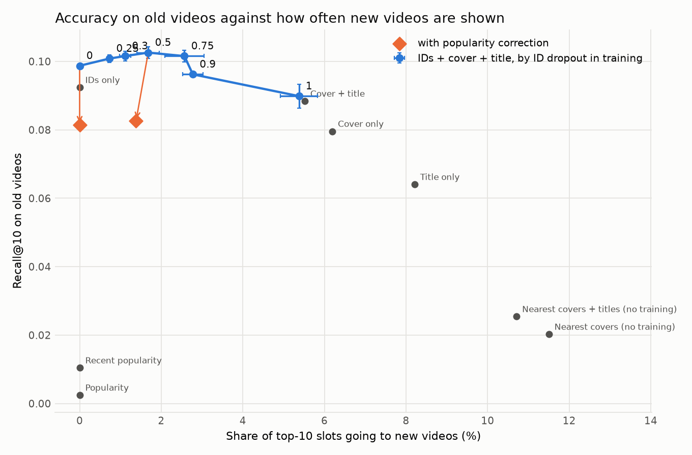
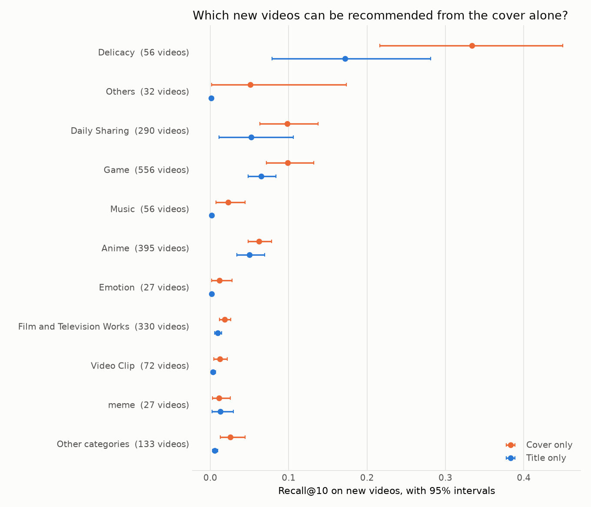

# The cold-start tax

When a short-video recommender gets better at videos it has seen before, how much does it bury the videos nobody has seen yet, and why?

## Why I cared

<!-- MYO: write 2–4 sentences on why you cared -->

## What I found

Giving a content-based recommender an ID for every video made it 13.0% better at recommending old videos, and cut the share of top-10 slots going to new videos by 79.3%, from 5.38% to 1.12%. Most of that burying is not about what the model knows. New videos get shorter vectors than old ones, so they score lower whatever they show.



Each point is a model. Up is better on old videos; right means new videos appear more often when old and new are ranked in one feed. The blue line is one model trained with its IDs hidden at different rates.

| ID dropout in training | Recall@10 on old videos | New videos' share of top-10 slots |
|---:|---:|---:|
| 0 | 0.0987 | 0.00% |
| 0.25 | 0.1008 | 0.73% |
| 0.3 | 0.1016 | 1.12% |
| 0.5 | 0.1026 | 1.68% |
| 0.75 | 0.1016 | 2.57% |
| 0.9 | 0.0962 | 2.77% |
| 1 (no IDs) | 0.0899 | 5.38% |

Three seeds each. Standard deviations and every other model are in [results/tradeoff.md](results/tradeoff.md).

The curve surprised me. I expected a steady trade. From dropout 0 to 0.75, accuracy on old videos stays between 0.0987 and 0.1026 while exposure goes from 0.00% to 2.57%. Some exposure for new videos is free. The price comes only at the end: removing IDs entirely costs 12.4% on old videos.

I think the model that never hides an ID is the wrong default. It is worse on old videos than the one that hides them half the time, and it shows no new videos at all.

## Two explanations, and a third

I set out to test two explanations.

**Popularity.** ID vectors soak up how popular each old video is, so old videos win on popularity alone. If so, taking popularity out of the scores should give new videos their exposure back cheaply.

**Capacity.** IDs carry real information that covers and titles do not, and only old videos have IDs. If so, removing popularity will not help.

Popularity did not hold. I trained with each video's popularity added to its score and ranked without it (the orange arrows). Accuracy on old videos fell by 17.5% and 19.4% at the two dropout rates I tried, and exposure did not rise (0.00% stayed 0.00%; 1.68% became 1.38%).

Then one number bothered me. The dropout 0 model gave new videos exactly 0.00% of slots, for every user and seed. That looked like a scale problem. An old video's vector is content plus an ID part. A new video's is content alone, and it is shorter: 4.89 against 6.72 on average in the dropout 0.5 model. So I multiplied the new videos' vectors by a factor, with nothing retrained.

| Factor on new videos (dropout 0.5 model) | New videos' share of slots | Recall@10, the new video a user took | Recall@10, the old video a user took |
|---|---:|---:|---:|
| 1 (as trained) | 1.68% | 0.0082 | 0.1009 |
| 1.25 | 19.80% | 0.0292 | 0.0897 |
| 1.37 (average lengths matched) | 40.38% | 0.0424 | 0.0780 |

Both recall columns rank the target among all videos, old and new. Full table and the dropout 0 model: [results/scale_test/scale_test.md](results/scale_test/scale_test.md).

So the answer has three parts:

1. Popularity is not the cause.
2. Vector length causes most of the burying.
3. ID dropout decides whether the new videos that get shown are the right ones. The dropout 0 model, stretched until lengths matched, reached 10.64% exposure but found the right new video only 0.0045 of the time. Its content part never learned to work alone.

My view is that "capacity" survives only as point 3. The tax is mostly a calibration problem.

## How I tested it

- **Data.** MicroLens-100K (Ni et al., 2023): 99,939 users and 19,738 short videos, each with a cover image, a title and a category. The newest 10% of videos by first appearance (1,974) are the new videos. No model sees an interaction with them in training.
- **Models.** A SASRec sequence model whose video vectors come from learned IDs, from frozen Chinese-CLIP cover and title features through a small trained layer, or from both. The loss is a full softmax cross-entropy over all old videos; the original SASRec paper used a sampled binary loss.
- **Measures.** Recall@10 with full ranking for each user's held-out old video. Exposure is the share of top-10 slots going to new videos when each of 98,295 test users gets one list drawn from all videos.
- **Training.** Three seeds. The learning rate was chosen per model family on validation only ([results/lr_search/chosen.md](results/lr_search/chosen.md)). Early stopping ended every run between epoch 16 and 107, against a cap of 300.
- **Baselines.** Popularity, recent popularity and nearest covers with no training, in [results/results.md](results/results.md).

Every number here is written by a script into `results/`. The process, failed runs included, is in [CHANGELOG.md](CHANGELOG.md).

## What the cover can and cannot describe

The cover is enough for some kinds of video and not for others. For new food videos (56 of them), the cover-only model put the right one in the top 10 among new videos 0.334 of the time, against 0.172 for the title-only model. For film and television clips (330 videos) it managed 0.018. Intervals are in [results/categories.md](results/categories.md); several categories are too small to rank.



A plate of food looks like what it is. A film still does not tell you which film.

## What did not work, and what I would do next

- **My first run was wrong.** Every model stopped at a 30-epoch cap, and the content models were far from trained. That run said IDs made old-video accuracy 78% better. Trained properly, the figure is 13.0%. I now check the best epoch against the cap before reading any result.
- **The stretch factors were tried on the test users**, with none chosen on validation. They show a cause. They are not yet a method.
- **Matching lengths overshoots.** New videos are 10% of the catalogue and got 40.38% of slots.
- **One comparison is missing.** The stretched models were measured among all videos and the content-only model among old videos only, so I cannot yet compare them like for like.
- **The titles are English translations** fed to a Chinese text encoder; the 100K release has no Chinese titles.
- **One popularity correction strength** was tried.
- **LoRA and Qwen2-VL** are in the code and were left out of this run. My earlier LoRA attempt was under-trained and is preliminary.

Next I would train the length matching in, by normalising vectors before scoring, and see whether the curve moves up and to the right as a whole.

## Run it

Open [notebooks/colab_end_to_end.ipynb](notebooks/colab_end_to_end.ipynb) on a Colab T4 and run all cells (about 6 hours 50 minutes), or:

```bash
pip install -r requirements.txt
python -m pytest
python scripts/download.py
bash scripts/run_all.sh
bash scripts/run_scale_test.sh
```

The data is downloaded by the code and never committed; its authors do not allow passing on modified copies.

## References

- Ni, Y. et al. (2023). *A Content-Driven Micro-Video Recommendation Dataset at Scale.* arXiv:2309.15379. <https://github.com/westlake-repl/MicroLens>
- Kang, W.-C., McAuley, J. (2018). *Self-Attentive Sequential Recommendation.* ICDM.
- Yang, A. et al. (2022). *Chinese CLIP: Contrastive Vision-Language Pretraining in Chinese.* arXiv:2211.01335.

Code: MIT licence. The MicroLens data is not part of this repository and stays under its authors' terms.
