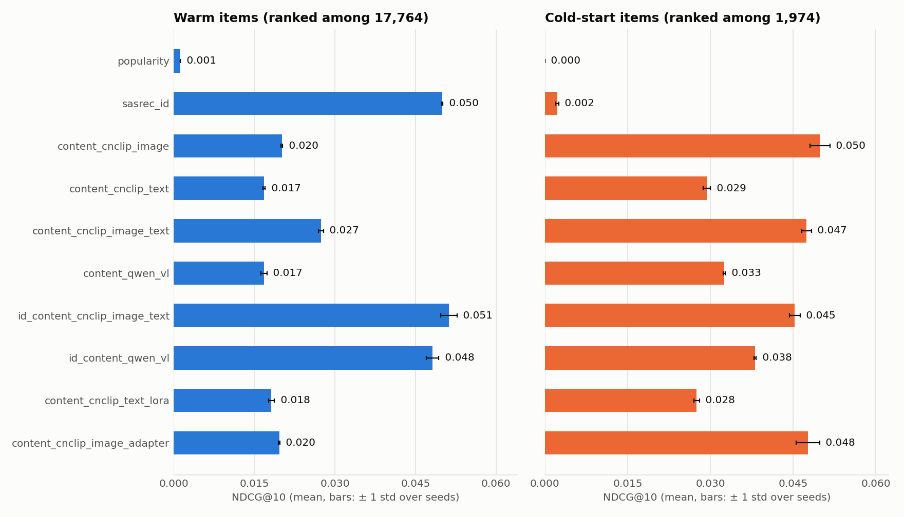
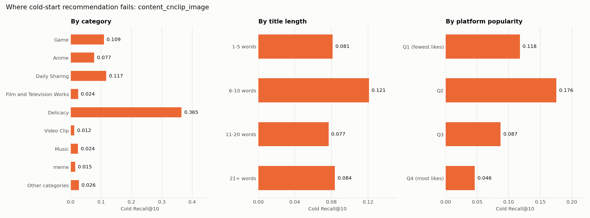

# Cold-start short-video recommendation with Chinese multimodal foundation models

> **Status: the results below are from the first run (code version `0daf84f`, one free Colab T4,
> seeds 0, 1, 2). The code has changed since and has not been re-run yet.** Every number is copied
> from [`results/results.md`](results/results.md) or [`results/error_slices.md`](results/error_slices.md),
> which `scripts/report.py` generates from the per-seed files in `results/runs/`.
>
> What changed after a review on 2026-11-12, and is **not** reflected in the numbers yet:
> training now runs to convergence (cap of 100 epochs, not 30); a matched warm setting makes warm
> and cold comparable; LoRA starts from a trained recommender and covers the image tower; an English
> text encoder reads the English titles; three training-free baselines are added; a cold example's
> candidates now exclude only the cold items the user took earlier. See
> [Pending re-run](#pending-re-run).
>
> The result files record code version `0daf84f`. On 2026-11-12 the commit author name and email
> were rewritten, which changed every commit hash; the same code is now commit `a5d00d2`. File
> contents were not changed by the rewrite.

**Short answer: no, not yet as well.** When a new video has to compete with established ones in a
single feed, the best content model finds it in the top 10 for 1.56% of cold test cases (Recall@10
0.0156, `content_cnclip_image`, "Cold vs all items"). An ID model does that for 9.02% of warm test
cases (Recall@10 0.0902, `sasrec_id`, "Warm"). Content embeddings turn cold-start from impossible
(an ID model scores exactly 0 in that setting) into possible, but a new video is still recommended
far less accurately than one with history.

Two things this answer does not rest on:

- The higher cold number in the table (Recall@10 0.0936) ranks a cold video only among the 1,974
  cold videos. The warm number ranks among 17,764. They are not comparable, and the first version
  of this README was wrong to set them side by side. A warm setting with the same number of
  candidates is now implemented and will be reported after the re-run.
- LoRA. In the first run it did not train (see RQ3), so that run says nothing about whether
  adapting the encoder helps.

## 1. Question

A short-video feed receives thousands of new videos a minute. A new video has no views, likes or
watch history, so a recommender that knows items only by their ID has nothing to go on. This
project asks:

> **When a new short video has no viewing history, can embeddings from Chinese open-source
> multimodal models (Chinese-CLIP, Qwen-VL) recommend it as well as a model that has seen its
> history, and how much does light fine-tuning (LoRA) help?**

| | Research question |
|---|---|
| **RQ1** | How much worse are ID-only sequential recommenders on cold-start items than on warm items? |
| **RQ2** | Do frozen image/text embeddings from Chinese-CLIP and Qwen-VL close that gap? Image, title, or both? |
| **RQ3** | Does adapting the encoder (LoRA, or a small adapter) help beyond frozen features, and at what compute cost? |
| **RQ4** | Which cold-start videos still fail (by category, title length, popularity)? |

## 2. Data

**MicroLens-100K** (Ni et al., 2023): 100,000 users, 19,738 short videos, 719,405 interactions,
with a cover image, a title, a category and platform like/view counts per video.

- The data is downloaded by `scripts/download.py` from the authors' server and is **never
  committed**: the authors prohibit redistributing modified copies. `data/` is git-ignored.
- A SHA-256 manifest of what was downloaded is written to `data/raw/manifest.json`.
- The 100K release ships **English titles only** (`MicroLens-100k_title_en.csv`); see Limitations.

## 3. Experimental design

### The split (this decides every number)

1. Order items by the time of their first interaction. The **newest 10% of items (1,974) are
   cold-start items**. Every interaction with them is removed from training, so no model sees a
   cold item's ID or any behaviour on it.
2. The remaining interactions form each user's *warm sequence*. Leave-one-out: the last warm item
   is the warm test target, the one before it the validation target, the rest is training.
3. Each removed interaction (user, cold item, time) is one **cold test example**: the input is the
   user's warm interactions before that time, the target is the cold item.

The split is implemented in [`src/data.py`](src/data.py) and checked by `tests/test_data.py`
(no cold item in training or in any model input; targets never appear in their own input).

### Models

All sequence models share one SASRec trunk (2 layers, 64 dimensions); only the source of the item
vectors changes ([`src/models.py`](src/models.py)). The training loss is a full-softmax
cross-entropy over all warm items at every position, not the binary cross-entropy with one sampled
negative of the original SASRec paper.

| Config | Item vector | Can it score a cold item? |
|---|---|---|
| `popularity` | none (training interaction counts) | No: cold items have a count of zero |
| `sasrec_id` | learned ID embedding | No: the cold item's embedding was never trained |
| `content_cnclip_image` / `_text` / `_image_text` | trained projection of **frozen** Chinese-CLIP features | Yes |
| `content_qwen_vl` | trained projection of a frozen Qwen2-VL embedding of cover + title | Yes |
| `id_content_*` | content vector + gate × ID vector (ID dropped for cold items, and randomly in training) | Yes |
| `content_cnclip_text_lora` / `_image_lora` | features re-extracted after LoRA fine-tuning of the encoder | Yes |

### Metrics

Recall@10 and NDCG@10 with **full ranking** (no sampled negatives), items the user already has
removed from the candidates, ties counted against the model ([`src/metrics.py`](src/metrics.py)).
Reported as mean ± sample standard deviation over 3 seeds, in three settings:

- **Warm**: warm test target ranked among all warm items.
- **Warm, matched** (added after the first run; no numbers yet): warm test target ranked among a
  fixed random sample of 1,974 warm items, the size of the cold set. This is the warm number that
  can be set against **Cold**.
- **Cold**: cold target ranked among all cold items ("which new video do we show this user?").
- **Cold vs all items**: cold target ranked among warm and cold items together. This is the
  realistic setting.

The settings have different numbers of candidates, so models are compared within a setting.
Model selection (early stopping) uses the warm validation set only.

### Adaptation (RQ3)

`scripts/finetune.py` trains LoRA matrices inside one Chinese-CLIP tower with the next-item loss
(in-batch softmax), on warm training sequences only. The adapted encoder then re-embeds every item
and the downstream model is trained with the **same config and number of epochs** as its frozen
counterpart. Time, peak GPU memory and trainable parameters are logged to `results/finetune/`.

## 4. Results

Full tables: [`results/results.md`](results/results.md) and
[`results/error_slices.md`](results/error_slices.md). Mean ± sample standard deviation over 3 seeds
(popularity is deterministic, 1 seed). Compare models **down a column**; warm and cold rank among
different numbers of candidates.

| Model | Warm R@10 | Warm N@10 | Cold R@10 | Cold N@10 | Cold vs all R@10 | Cold vs all N@10 |
|---|---:|---:|---:|---:|---:|---:|
| `popularity` | 0.0025 | 0.0012 | 0.0000 | 0.0000 | 0.0000 | 0.0000 |
| `sasrec_id` | 0.0902 ± 0.0001 | 0.0500 ± 0.0001 | 0.0048 ± 0.0002 | 0.0022 ± 0.0003 | 0.0000 ± 0.0000 | 0.0000 ± 0.0000 |
| `content_cnclip_image` | 0.0393 ± 0.0004 | 0.0201 ± 0.0002 | 0.0936 ± 0.0017 | 0.0499 ± 0.0018 | 0.0156 ± 0.0008 | 0.0081 ± 0.0002 |
| `content_cnclip_text` | 0.0332 ± 0.0002 | 0.0168 ± 0.0002 | 0.0520 ± 0.0019 | 0.0294 ± 0.0006 | 0.0112 ± 0.0005 | 0.0053 ± 0.0002 |
| `content_cnclip_image_text` | 0.0528 ± 0.0008 | 0.0274 ± 0.0005 | 0.0886 ± 0.0005 | 0.0474 ± 0.0009 | 0.0155 ± 0.0005 | 0.0083 ± 0.0004 |
| `content_qwen_vl` | 0.0340 ± 0.0002 | 0.0168 ± 0.0006 | 0.0649 ± 0.0003 | 0.0325 ± 0.0002 | 0.0106 ± 0.0007 | 0.0050 ± 0.0004 |
| `id_content_cnclip_image_text` | 0.0940 ± 0.0023 | 0.0512 ± 0.0015 | 0.0846 ± 0.0015 | 0.0453 ± 0.0009 | 0.0059 ± 0.0004 | 0.0024 ± 0.0001 |
| `id_content_qwen_vl` | 0.0901 ± 0.0013 | 0.0482 ± 0.0012 | 0.0741 ± 0.0012 | 0.0381 ± 0.0002 | 0.0050 ± 0.0004 | 0.0019 ± 0.0002 |
| `content_cnclip_text_lora` | 0.0348 ± 0.0006 | 0.0182 ± 0.0006 | 0.0508 ± 0.0007 | 0.0275 ± 0.0005 | 0.0072 ± 0.0004 | 0.0033 ± 0.0003 |
| `content_cnclip_image_adapter` | 0.0384 ± 0.0006 | 0.0196 ± 0.0001 | 0.0913 ± 0.0031 | 0.0477 ± 0.0022 | 0.0151 ± 0.0018 | 0.0072 ± 0.0004 |
| *random ranker (expected)* | 0.0006 | | 0.0051 | | 0.0005 | |



### RQ1: how much worse is an ID-only model on cold items?

It does not work at all. `sasrec_id` reaches cold Recall@10 of 0.0048, against 0.0051 expected from
a random ranker over the 1,974 cold items, and exactly 0 when cold items compete with warm ones.
On warm items the same model is the strong baseline (Recall@10 0.0902).

### RQ2: do frozen content embeddings close the gap?

Yes for cold items, at a cost on warm items.

- **Cover image is the strongest single signal.** `content_cnclip_image` reaches cold Recall@10
  0.0936, about 18 times the random level. Titles alone reach 0.0520.
- **Adding the title to the image does not help cold items** (0.0886 vs 0.0936) but does help warm
  items (0.0528 vs 0.0393).
- **Content-only models lose on warm items:** the best one reaches warm NDCG@10 0.0274 against
  0.0500 for the ID model.
- **ID + content gets both:** `id_content_cnclip_image_text` matches the ID model on warm items
  (0.0512 vs 0.0500 NDCG@10) and keeps most of the cold performance (0.0453 vs 0.0499).
- **Qwen2-VL embeddings were weaker than Chinese-CLIP here** (cold NDCG@10 0.0325 vs 0.0474 for
  image + text) and much slower to extract. The extraction times of the first run were not saved
  in this repository, so no figure is quoted; the re-run commits them. This tests one simple
  recipe (mean-pooled last hidden state of the 2B model), not Qwen2-VL in general.
- **Cold vs all items stays hard.** When cold videos compete with warm ones, the best content
  model reaches Recall@10 0.0156, and the ID + content models drop to 0.0059: their trained ID
  vectors favour warm items.

### RQ3: does adapting the encoder help?

**The first run cannot answer this.** The fine-tuning did not train, for a reason that is now
fixed in the code but not yet re-run.

| Stage | Steps | Seconds | Peak GPU MB | Trainable encoder params | First loss | Last loss |
|---|---:|---:|---:|---:|---:|---:|
| `cnclip_image_adapter` | 392 | 6 | 100 | 262,912 | 6.959 | 6.788 |
| `lora_text` | 3,134 | 750 | 3935 | 294,912 | 4.929 | 4.945 |

- **Text LoRA did not learn.** The fine-tuning loss did not go down (4.929 to 4.945 over one
  epoch). The recommender on top of the text tower started from random weights and shared the
  LoRA learning rate of 1e-4, so the tower was updated through an untrained model.
- **It made the realistic setting worse.** With the re-extracted features, cold NDCG@10 fell
  slightly among cold items (0.0275 vs 0.0294) and Recall@10 against all items fell from 0.0112 to
  0.0072. Warm NDCG@10 rose slightly (0.0182 vs 0.0168).
- **The image adapter is dropped from the comparison.** It was within noise of frozen image
  features (cold NDCG@10 0.0477 ± 0.0022 vs 0.0499 ± 0.0018), which is what one should expect: the
  downstream model already trains a small MLP on the same features, so an adapter adds nothing.
- **Image-tower LoRA was not run**, although the cover image is the strongest signal.

What the code does now: the projection and the SASRec trunk start from the trained
`content_cnclip_*` model, they use a learning rate of 1e-3 while the LoRA matrices use 1e-4, the
text tower gets 3 epochs, and the image tower is fine-tuned too (batch 8, gradient checkpointing,
a fixed step budget).

### RQ4: which cold videos still fail?

Cold Recall@10 for `content_cnclip_image`, pooled over seeds
([all models](results/error_slices.md)):



Test examples per slice are in brackets (of 77,753 cold test examples).

- **Results differ a lot by category.** Food ("Delicacy", 2,799 examples) reaches 0.3647, daily
  sharing (8,924) 0.1171 and games (34,549) 0.1092, while film and television (7,951) reaches
  0.0241, music (1,365) 0.0237, memes (1,213) 0.0146 and video clips (2,410) 0.0116. The slices
  show where the model fails, not why. One guess is that a cover frame identifies a dish better
  than a film clip or a song, but nothing here tests that, and the smaller categories rest on
  about a thousand examples.
- **The most-liked videos are the hardest, but the relation is not monotonic.** By quartile of
  platform likes: 0.1177 (fewest likes, 11,372 examples), 0.1757 (15,230), 0.0870 (22,098) and
  0.0460 (most likes, 29,053).
- **For long titles the text model is ahead.** For titles of 21+ words (10,287 examples),
  `content_cnclip_text` reaches 0.0981 against 0.0838 for the image model; for titles of 1 to 5
  words (14,723) it is far behind (0.0268 vs 0.0815).
- **Qwen2-VL is ahead on "Video Clip"** (0.0407, and 0.0602 with the ID added, against 0.0116), the
  one category where it clearly beats Chinese-CLIP image features. That is 2,410 examples.

## 5. Limitations

- **One dataset**, from one platform, already filtered to active users and items.
- **Likes as implicit feedback**: an interaction is a positive signal only; there are no explicit negatives or watch times.
- **Covers, not video**: one cover frame stands in for the whole clip.
- **English titles into a Chinese text encoder**: MicroLens-100K provides machine-translated
  English titles. Chinese-CLIP's text tower was trained on Chinese, so the title results above
  understate what titles can do. An English CLIP text tower (`content_enclip_text`) is now in the
  code for comparison; it has not been run yet.
- **The split is per item, not a global time cutoff.** A warm interaction that happens after a
  cold item first appears is still training data, so the sequence model has seen some of the
  period it is tested on. This favours every model equally but is not what a live system sees.
- **Items without a cover share one vector.** An item with no cover file gets an all-zero image
  feature. The count is written by the embedding step and will be reported with the re-run.
- **Cold items are simulated**: they are the newest items of a finished dataset. All other items'
  full histories are available, unlike a live system.
- **No cold validation set**: hyperparameters and the stopping epoch are chosen on warm data.
- **LoRA is fine-tuned with one seed**; the ± only covers the downstream model's seeds.
- **The first run stopped at its 30-epoch cap, not at convergence.** Every run's best validation
  epoch was 28 to 30, so early stopping never triggered and all models, baselines included, are
  under-trained in the numbers above. The cap is now 100.
- **One run of the pipeline.** Standard deviations are over 3 seeds of the downstream model only.
- **Small models and budget**: one free Colab T4, a 64-dimensional SASRec, no hyperparameter search.

## Pending re-run

The numbers in section 4 come from the first version of the code. These changes are implemented
and tested but have no results yet:

| Change | Why |
|---|---|
| Epoch cap 100 (was 30), patience 5 | Every first-run model had its best epoch at 28 to 30, so none had converged |
| "Warm, matched" setting | A warm number with as many candidates as the cold setting |
| Cold candidates exclude only earlier cold items | A cold video the user takes later is a legitimate candidate |
| LoRA starts from a trained content model, 1e-3 for the recommender, 3 epochs, image tower too | The first LoRA run did not train |
| `content_enclip_text`, `content_cnclip_image_enclip_text` | English titles read by an English text tower |
| `popularity_recent`, `popularity_category`, `knn_cnclip_image`, `knn_cnclip_image_text` | Baselines that need no training |
| Paired bootstrap over test examples | Whether close results (image vs image + text, ID + content vs ID) differ by more than noise |
| Run log and feature metadata saved under `results/` | So that every runtime and count can be traced |

The re-run replaces `results/` and this README's results section. Until then, treat section 4 as
a record of the first run.

## 6. Reproduce

Open [`notebooks/colab_end_to_end.ipynb`](notebooks/colab_end_to_end.ipynb) in Colab with a T4 GPU
and run all cells. After the download, `bash scripts/run_all.sh` runs every experiment in order.
The run time of the current code has not been measured. Or, step by step:

```bash
pip install -r requirements.txt
python -m pytest                                      # 63 tests, about a minute on CPU
python scripts/download.py                            # ~710 MB into data/raw/
python scripts/embed.py --model cnclip                # GPU
python scripts/embed.py --model enclip                # GPU
python scripts/train.py --config configs/sasrec_id.yaml --seeds 0 1 2   # repeat per config
python scripts/train.py --config configs/content_cnclip_text.yaml --seeds 0 1 2 --set train.save_model=true
python scripts/finetune.py --mode lora --modality text --init-from checkpoints/content_cnclip_text_seed0.pt   # GPU
python scripts/embed.py --model cnclip --what text --lora-dir checkpoints/lora_text --tag lora
python scripts/train.py --config configs/content_cnclip_text_lora.yaml --seeds 0 1 2
python scripts/report.py                              # writes results/results.md and the charts
```

## 7. Repository layout

```
configs/    base.yaml plus one small file per model
scripts/    download.py  embed.py  train.py  finetune.py  report.py
src/        data.py (split)  metrics.py  models.py  train.py  features.py  finetune.py
tests/      unit tests on toy data and a tiny offline Chinese-CLIP
notebooks/  colab_end_to_end.ipynb
results/    written by the scripts: runs/<model>/seed<k>/metrics.json, results.md, charts
```

## References

- Ni, Y., Cheng, Y., Liu, X., Fu, J., Li, Y., He, X., Zhang, Y., Yuan, F. (2023). *A Content-Driven Micro-Video Recommendation Dataset at Scale.* arXiv:2309.15379. <https://github.com/westlake-repl/MicroLens>
- Kang, W.-C., McAuley, J. (2018). *Self-Attentive Sequential Recommendation.* ICDM.
- Yang, A. et al. (2022). *Chinese CLIP: Contrastive Vision-Language Pretraining in Chinese.* arXiv:2211.01335.
- Wang, P. et al. (2024). *Qwen2-VL: Enhancing Vision-Language Model's Perception of the World at Any Resolution.* arXiv:2409.12191.
- Hu, E. et al. (2022). *LoRA: Low-Rank Adaptation of Large Language Models.* ICLR.

## Licence

Code: MIT. The MicroLens data is not part of this repository and remains under its authors' terms.
